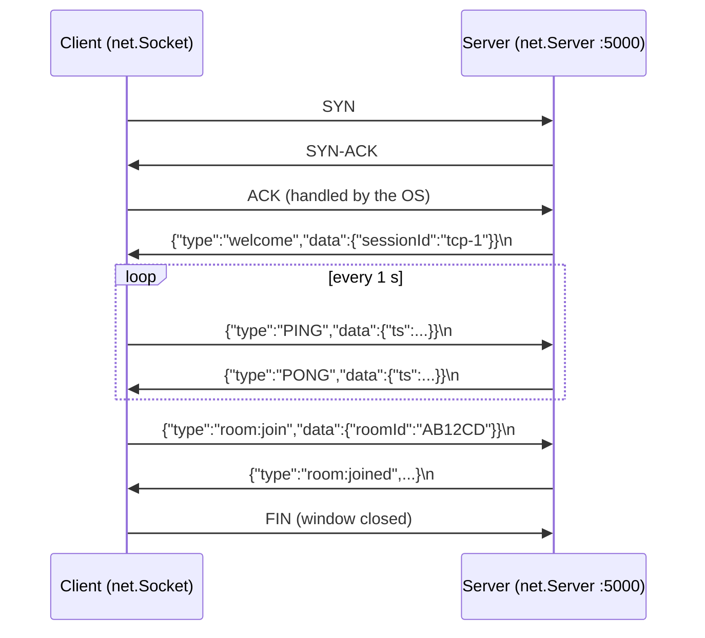
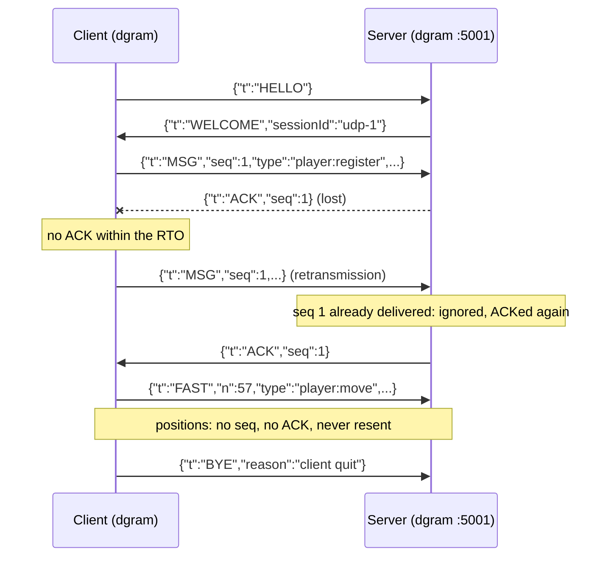

# Among Us Arena: one game, two transports (TCP and UDP)

Among Us Arena is a competitive multiplayer game for 3 players (1 imposter, 2 crewmates) built for the
Computer Networks course, Project 2. One server and three clients run on four separate computers and talk
over **real network sockets**.

The game exists in **two versions with identical rules and features**. Only the transport changes:

| | TCP version | UDP version |
|---|---|---|
| Transport | TCP only | UDP only, **no TCP at all** |
| Node.js module | `net` | `dgram` |
| Default port | **5000** | **5001** |
| Connection | TCP 3-way handshake (done by the OS) | our own `HELLO` → `WELCOME` handshake |
| Message boundaries | none (byte stream): we add one JSON message per line | built in: one JSON message per datagram |
| Reliability and ordering | done by the OS's TCP stack | our own: sequence numbers, ACKs, retransmission, de-duplication, reordering |
| Positions (20 per second) | reliable, like everything else in TCP | unreliable on purpose (a lost one is replaced 50 ms later) |
| Dead-peer detection | `close`/`error` events + our 1 s heartbeat, 5 s timeout | our 1 s heartbeat, 5 s timeout, retransmission limit, `BYE` |

**No networking library** is used: no Socket.IO, no Express, no HTTP, no WebSocket. Only Node's built-in
`net` and `dgram` modules.

**Contents:**
1. [The game](#1-the-game)
2. [Architecture](#2-architecture)
3. [How the networking works](#3-how-the-networking-works)
4. [Installation](#4-installation)
5. [Running the TCP version](#5-running-the-tcp-version)
6. [Running the UDP version](#6-running-the-udp-version)
7. [Where to run what (one PC, LAN, Tailscale)](#7-where-to-run-what)
8. [Watching the network: HUD, statistics, Wireshark](#8-watching-the-network-hud-statistics-wireshark)
9. [Automated network test](#9-automated-network-test)
10. [Troubleshooting](#10-troubleshooting)
11. [Project structure](#11-project-structure)

---

## 1. The game

1. Each player enters a name, a password, and optionally a color. A new name creates an account.
   The same name later is a login: a wrong password is refused. The server assigns the player id.
2. One player creates a room; the others see it appear in their room list and join it.
3. The host starts the game. Each player privately learns whether they are the imposter.
4. The imposter kills crewmates (10 s cooldown, must be close). Any living player can call an emergency
   meeting (once per game); everyone alive votes for a suspect or skips.
5. **Crew wins** if the imposter is voted out (or leaves). **Imposter wins** by killing both crewmates.
6. The end screen shows the winner and the **ranking**; **Play again** starts a new game in the same room
   (the imposter role rotates and scores add up).

| Event | Points |
|---|---|
| Kill | +1 (imposter) |
| Vote for the imposter during a meeting | +1 |
| Crew wins | +2 to every crewmate (alive or dead) |
| Imposter wins | +3 to the imposter |

| Key / button | Action |
|---|---|
| `Z` `Q` `S` `D` | move up / left / down / right (AZERTY layout) |
| **KILL** (imposter only) | kill the nearest player |
| **USE** (near the central table) | call an emergency meeting |
| Click a player, then ✔ / **Skip** | vote during a meeting |
| `F3` | show / hide the network HUD |
| **Leave** | leave the room |

---

## 2. Architecture

```
 Client computer (x3)                                         Server computer
 +----------------------------------------------+             +-------------------------------------+
 |  Browser tab: React + Phaser game            |             |  backend/src/main.js                |
 |     |  http://localhost:8080  <-- loopback,  |             |    game rules: events/*.js          |
 |     |              never leaves the PC       |             |    (shared by both versions)        |
 |  Local agent: web/agent.cjs (Node.js)        |             |              |                      |
 |     tcpClient.cjs  -> net.Socket   ==========|== TCP 5000 =|=> transport/tcpServer.js  (net)     |
 |  or udpClient.cjs  -> dgram.Socket ==========|== UDP 5001 =|=> transport/udpServer.js  (dgram)   |
 +----------------------------------------------+             +-------------------------------------+
```

**Why a local agent next to the browser?** A web page is not allowed to open raw TCP or UDP sockets:
browsers only offer HTTP, WebSocket and WebRTC, which are protocols built on top and would hide the
transport (and the UDP version must use no TCP at all). So the game is played in a normal browser tab, and
a small Node.js program on the same computer, the **agent** (`frontend/web/agent.cjs`), owns the real
`net` / `dgram` socket. The agent serves the UI from disk (`frontend/dist`) and talks to the tab over HTTP
on `127.0.0.1` only (Server-Sent Events for server → page, `POST /net/send` for page → server). That is
loopback: it never reaches the network, and Wireshark on Wi-Fi/Ethernet/Tailscale never sees it.
**So the only game traffic leaving a client is our own TCP segments (TCP version) or UDP datagrams (UDP version).**

The **desktop version** (Electron) still exists and works the same way, with Electron IPC instead of the
loopback HTTP: `npm run desktop:tcp` / `npm run desktop:udp`. Both use the same `tcpClient.cjs` /
`udpClient.cjs`, and the page talks to either through the same small interface (`src/services/net.js`).

**One game, two transports.** Both server transports expose the same 4 operations, and the game rules only
use those:

```js
transport.on('connect',    (sessionId, address) => {})    // a client is now reachable
transport.on('message',    (sessionId, type, data) => {})  // one complete message arrived
transport.on('disconnect', (sessionId, reason) => {})     // client quit, crashed or timed out
transport.send(sessionId, type, data)                      // send one message to one client
```
`main.js` picks `tcpServer.js` or `udpServer.js` from `--proto`; nothing else in the backend mentions `net`
or `dgram`. The clients do the same: `tcpClient.cjs` and `udpClient.cjs` have the same interface
(`send`, `close`, `status`, `stats`).

**The server is authoritative.** Clients only send requests ("I want to kill X"); the server checks the
rules against its own state (roles, positions, cooldowns, meeting timer) and then tells everyone what
happened. Refusals come back privately as `game:notif`.

---

## 3. How the networking works

### 3.1 Common to both versions

**Sessions: who is who.** The server identifies a client by the transport, never by what a message says:
- TCP: one session = one accepted TCP connection (one socket per client), ids `tcp-1`, `tcp-2`...
- UDP: one session = one remote `ip:port` that completed the `HELLO` → `WELCOME` handshake, ids `udp-1`...

When a player registers or logs in, the server checks the password (stored as a scrypt hash in
`backend/data/users.json`) and binds that account's player id to their session. The client does not
choose the id. Later messages carry no player id: a client cannot act on behalf of someone else.
The password is hashed with `crypto.scrypt` and a per-user random salt, off the main thread, so a login
never pauses the game for the other players.
Movement is checked on the server, whose position is authoritative: a position outside the map is
clamped to the map bounds, and a move faster than the client is allowed to walk (350 px/s in the lobby,
100 px/s in a game) is refused. In both cases the sender gets the server's position back
(`player:moved` with `corrected: true`). The limits are in [`backend/src/config.js`](backend/src/config.js).

**Wire format: readable JSON**, so every message can be read directly in Wireshark:
```json
{"type":"room:join","data":{"roomId":"AB12CD"}}
```

**Heartbeat.** Every client sends `PING {ts}` once per second; the server answers `PONG` with the same
timestamp, so `now - ts` = **round-trip time (RTT)**. If either side hears **nothing for 5 seconds**, it
considers the other side gone. This matters even for TCP: when a cable is pulled or a laptop sleeps, no
packet arrives to say so, and TCP's own keep-alive would take about 2 hours by default.

**Room broadcast = one send per player.** Neither TCP nor UDP unicast has "rooms". Sending to a room of 3
players is 3 separate sends: 3 TCP writes, or 3 UDP datagrams.

**What happens on a disconnection.** Whatever the cause (clean quit, crash, timeout), the server removes
the player from their room and tells the others (`player:left` with the reason). It hands the host role to
someone else if needed, finishes a meeting if the leaver was the last voter, and ends the game if a side
has won (imposter left = crew wins). The client that lost the server shows "Connection lost, reconnecting…",
reconnects by itself, and returns to the menu.

All constants are in [`shared/protocol.cjs`](shared/protocol.cjs), used by both server and client:

| Constant | Value | Meaning |
|---|---|---|
| `DEFAULT_TCP_PORT` / `DEFAULT_UDP_PORT` | 5000 / 5001 | |
| `HEARTBEAT_INTERVAL_MS` | 1000 | a PING every second |
| `TIMEOUT_MS` | 5000 | silence after which the peer is considered gone |
| `MIN_RTO_MS` / `MAX_RTO_MS` / `INITIAL_RTO_MS` | 100 / 1000 / 200 | UDP retransmission timeout bounds |
| `MAX_RETRIES` | 25 | UDP: resends without ACK before giving up on the peer |
| `MAX_DATAGRAM_BYTES` | 1200 | keep datagrams below the MTU (1500 Ethernet, 1280 Tailscale): no IP fragmentation |
| `UNRELIABLE_TYPES` | `player:move`, `player:moved` | UDP messages sent without reliability |

### 3.2 The TCP version

Files: [`backend/src/transport/tcpServer.js`](backend/src/transport/tcpServer.js),
[`frontend/electron/tcpClient.cjs`](frontend/electron/tcpClient.cjs),
[`shared/lineFramer.cjs`](shared/lineFramer.cjs).

**What the operating system does for us:** the 3-way handshake (SYN, SYN-ACK, ACK), sequence numbers,
ACKs, retransmission of lost segments, in-order delivery, and FIN/RST when a connection closes.

**What our code still has to do:**

1. **Framing.** TCP is a *byte stream*: one `data` event may contain half a message, or several messages
   glued together. Our rule is one JSON object followed by `\n`. `JSON.stringify` never produces a raw
   newline, so `\n` can only mean "end of message". `LineFramer` buffers bytes until a newline arrives
   (with a `StringDecoder`, so a UTF-8 character split between two chunks is not broken). It also discards
   a line longer than 64 KB.
   ```
   {"type":"player:move","data":{"x":612,"y":154,"d":"right","moving":true}}\n
   ```
2. **No Nagle delay.** `socket.setNoDelay(true)`: by default TCP waits to group small writes into one
   segment, which adds latency to our small, frequent messages.
3. **Being "connected".** The client counts as connected only after the server's first message
   `{"type":"welcome","data":{"sessionId":"tcp-3"}}`, not just after the handshake.
4. **Detecting a dead peer.** Different failures look different in TCP:

   | What happened | What TCP reports | Detected after |
   |---|---|---|
   | Window closed normally | FIN → `close` event | instantly |
   | Process killed / crashed | the OS sends RST or FIN → `close` | instantly |
   | Cable pulled, Wi-Fi lost, laptop asleep | **nothing** | 5 s (our heartbeat) |

5. **Reconnecting.** A dead TCP connection cannot be reused. The client opens a brand-new connection
   (new handshake, new local port, new session) every 2 s until it works. `ECONNREFUSED` means nothing
   listens on that port, i.e. the server is not running.



**TCP's weakness for a game: head-of-line blocking.** Every byte is delivered in order. If one segment
carrying a position is lost, every position queued behind it waits for the retransmission, even though a
newer position already makes the old one useless.

### 3.3 The UDP version

Files: [`backend/src/transport/udpServer.js`](backend/src/transport/udpServer.js),
[`frontend/electron/udpClient.cjs`](frontend/electron/udpClient.cjs),
[`shared/reliableUdp.cjs`](shared/reliableUdp.cjs).

UDP gives each `send()` as one independent datagram that may be **lost, duplicated or reordered**, with
**no connection** and nothing that tells you when the other side disappears. The server has **one socket
for all clients**; each datagram says who sent it (`rinfo.address:rinfo.port`, from the IP and UDP
headers). The client binds a port chosen by the OS (`bind(0)`).

**Packet kinds** (one JSON object per datagram, field `t`):

| `t` | Direction | Purpose |
|---|---|---|
| `HELLO` | client → server | "I want a session" (sent every 1 s until answered) |
| `WELCOME {sessionId, tok}` | server → client | session created; `tok` = random session token. Every later datagram, in both directions, carries it, and a datagram from the right `ip:port` with a wrong or missing token is dropped (a forged source address is not enough to act as a client) |
| `PING {ts}` / `PONG {ts}` | client → server / back | heartbeat + RTT |
| `MSG {seq, type, data}` | both | **reliable** game message (needs an ACK) |
| `ACK {seq}` | both | "I received MSG number `seq`" |
| `FAST {n, type, data}` | both | **unreliable** message (positions only) |
| `BYE {reason}` | both | leaving / "I don't know you, send HELLO" |

**Our reliability layer (`ReliableChannel`, one per client on the server, one on each client):**

1. **Sequence numbers:** each reliable message gets `seq` = 1, 2, 3...
2. **ACKs:** the receiver answers `ACK {seq}` for every `MSG`, even a duplicate (a duplicate usually means
   our previous ACK was lost).
3. **Retransmission:** every 50 ms the sender resends any `MSG` not acknowledged within the
   **RTO** (retransmission timeout) = 2 × smoothed RTT, kept between 100 and 1000 ms (200 ms before the
   first measurement). The RTT is smoothed like TCP does (`srtt = 0.875·srtt + 0.125·sample`) and only
   measured on messages sent once (**Karn's rule**: for a resent message we can't tell which copy the ACK
   answers).
4. **De-duplication:** a `seq` already delivered is acknowledged again but not delivered twice.
5. **In-order delivery:** if `seq 8` arrives before `seq 7`, it waits; when 7 arrives, 7 then 8 are
   delivered.
6. **Giving up:** after `MAX_RETRIES` (25) resends without an ACK, the peer is considered dead.



**Unreliable `FAST` packets for positions.** Each client sends its position 20 times per second. If one is
lost, the next one replaces it 50 ms later, so resending it would deliver an outdated position. `FAST`
packets carry a counter `n`; a position older than the last one received from the same player is dropped
(`staleDropped`). Everything else (register, join, kill, vote, game end...) is reliable.

**Sessions and disconnections:**

| Situation | What happens |
|---|---|
| Client quits | it sends `BYE`; the server removes it at once |
| `BYE` lost, process crashed, cable pulled | silence → 5 s timeout (or the retransmission limit, if messages were waiting for an ACK) |
| Server restarted / timed the client out | the server answers the client's next packet with `BYE "unknown session, send HELLO"` |
| Any disconnection on the client side | the client drops its channel and goes back to sending `HELLO` every second |
| `HELLO` from an address the server already knows | the client restarted: the server starts a fresh session (sequence numbers back to 1) |

**Simulated loss (UDP only).** `--loss 0.1` on the server or on a client drops 10% of the datagrams it sends
*and* receives, before they reach the socket, and counts them as `simulatedLoss`. This shows the
reliability layer at work. TCP has no such option: in TCP, losses are repaired by the OS below our code,
and dropping bytes ourselves would break the stream. To test TCP under loss, impair the network itself
(`clumsy` on Windows, `tc netem` on Linux).

### 3.4 How often messages are sent

| Message | Rate | UDP channel |
|---|---|---|
| `PING` / `PONG` | 1 per second | plain datagram |
| `player:move` while moving | 20 per second (every 50 ms) | `FAST` (unreliable) |
| `player:move` while standing still | 2 per second (keeps the server's copy fresh for the kill-range check) | `FAST` |
| `player:move` when starting/stopping | immediately | `FAST` |
| everything else | on events | `MSG` (reliable) |

The server relays a position only to the *other* players. On screen, other players glide 30% of the way
toward their last received position every frame (and jump if more than 200 px away), so 20 updates per
second, or a few lost ones, still look smooth.

### 3.5 Message reference

Client → server (the player is always identified from the session, never from the payload):

| Message | Payload | Reply |
|---|---|---|
| `player:register` | `{name, password, color}` | `player:registered {playerId, name, color}` + `rooms:list`, or `player:register:error {message}` (`Wrong password` if the account exists and the password does not match). Any `id` in the payload is ignored. |
| `player:unregister` | `{}` | `player:unregistered` |
| `rooms:get` | `{}` | `rooms:list {rooms}` |
| `room:create` | `{roomId}` | `room:joined`, or `room:join:error {message}` |
| `room:join` | `{roomId}` | `room:joined {roomId, room, player}`, or `room:join:error {message}` |
| `room:leave` | `{}` | others get `player:left` |
| `room:get` | `{}` | `room:state {room, player}` |
| `game:start` | `{}` (host only) | each player privately gets `game:started {roomId, isImposter}` |
| `player:move` | `{x, y, d, moving}` | accepted moves: others get `player:moved {id, x, y, d, moving}`. Rejected moves (outside the map, or faster than max speed): the sender alone gets `player:moved` with `corrected: true` and the server's position |
| `player:kill` | `{playerId}` (victim) | everyone gets `player:killed {playerId, killerId, x, y, color}`, or `game:notif` |
| `meeting:start` | `{}` | everyone gets `meeting:started {callerId, durationMs, players}` |
| `meeting:vote` | `{votedForId}` or `'skip'` | everyone gets `meeting:voted {callerId}` (choice hidden), then `meeting:ended {results}` |

Server → clients, unprompted: `rooms:list` (pushed to everyone on every room change), `player:joined`,
`player:left {playerId, reason}`, `room:host {hostId}`, `game:ended {isImposter, imposterId, imposterName, ranking}`,
`game:notif {message}`. The room list never contains the imposter's identity.

### 3.6 Measured behaviour (from the automated tests, on one PC)

| Situation | TCP | UDP |
|---|---|---|
| Window closed normally | ~0.1 s (FIN) | ~0.1 s (BYE); 5 s if the BYE datagram is lost |
| Client process killed | ~0 s (the OS sends RST) | 2.6–5 s (only silence reveals it) |
| Server killed, seen by the clients | 0.2 s | 5.1 s |
| Cable pulled (all traffic silently dropped) | 5 s on both sides (heartbeat) | 2.6–5 s |
| Network back | new TCP connection after ≤ 2 s | new `HELLO` → `WELCOME` within 1 s |
| 20% loss each side | not applicable (`--loss` is UDP only) | game fully playable; HUD shows e.g. `retrans 15 · dup 9 · out-of-order 2` |

---

## 4. Installation

Requirements: **Node.js 20 or newer** (tested with Node 22) and npm on every computer; Windows, macOS or
Linux (commands below are for Windows PowerShell and work the same elsewhere). Optional: Wireshark, and
Tailscale for the cross-network setup.

```powershell
git clone https://github.com/ZeinebMegaadi/among-us-web-port.git
cd among-us-web-port
```

**Server computer:**
```powershell
cd backend
npm install        # no dependencies: only Node's built-in modules
```

**Each client computer:**
```powershell
cd frontend
npm install        # first time only (also downloads Electron, used only by the desktop version)
npm run build      # builds the game UI into frontend/dist (again after any change in src/)
```
Any recent browser works (Chrome, Edge, Firefox).

---

## 5. Running the TCP version

**1. Server** (server computer):
```powershell
cd backend
npm run tcp
```
```
[TCP] game server listening on 0.0.0.0:5000
[server] Among Us Arena game server, TCP version, port 5000
```
`0.0.0.0` = listen on every network interface (Wi-Fi, Ethernet, Tailscale).

**2. One client per player** (client computers):
```powershell
cd frontend
npm run tcp -- --server <SERVER_IP>        # e.g. npm run tcp -- --server 192.168.1.20
```
The agent opens the game in your browser at `http://localhost:8080` (if that port is taken, 8081, 8082...;
the address is printed). The network bar at the top of the page shows
`TCP → 192.168.1.20:5000 · connected`; the server prints `[TCP] + tcp-1 connected from 192.168.1.31:52144`.

**3. Play** ([section 1](#1-the-game)). Closing the tab (or Ctrl+C in the agent's terminal) leaves the game:
5 s later the agent closes its socket with a TCP FIN, and the server removes the player at once.

## 6. Running the UDP version

**1. Server** (server computer):
```powershell
cd backend
npm run udp
```
```
[UDP] game server listening on 0.0.0.0:5001
[server] Among Us Arena game server, UDP version, port 5001
```

**2. One client per player** (client computers):
```powershell
cd frontend
npm run udp -- --server <SERVER_IP>
```
The agent sends `HELLO` every second until the server answers `WELCOME`, and opens the game in your
browser; the network bar then shows `UDP → 192.168.1.20:5001 · connected`.

**3. Optional: show the reliability layer under loss**
```powershell
npm run udp -- --loss 0.1                          # server (backend folder)
npm run udp -- --server <SERVER_IP> --loss 0.1     # a client (frontend folder)
```
> Loss on one side (or 0.1 on both) is enough for a demo. `0.2` on both sides means about 36% loss per
> direction; an idle client can then occasionally miss 5 heartbeats in a row and be disconnected.

**4. Play.** Closing the tab sends `BYE` 5 s later; if that datagram is lost, the server removes the player
after its 5 s timeout.

---

## 7. Where to run what

### One computer (testing)
Four terminals (`udp` instead of `tcp` for the UDP version):
```powershell
cd backend;  npm run tcp        # terminal 1: server
cd frontend; npm run tcp        # terminals 2, 3, 4: one agent each -> opens localhost:8080, 8081, 8082
```
Put the 3 game tabs in **3 separate browser windows** side by side, not 3 tabs of one window: browsers
pause the game loop of hidden tabs, so a background tab would stop sending its position.

### Four computers on the same network (live demo)
1. Connect the 4 computers to the same Wi-Fi/router (campus networks often block device-to-device traffic:
   use your own router, a phone hotspot, or Tailscale).
2. Server IP: run `ipconfig` on the server → "IPv4 Address" (e.g. `192.168.1.20`).
3. Open the server's firewall once, in **PowerShell as Administrator**:
   ```powershell
   New-NetFirewallRule -DisplayName "Among Us Arena TCP 5000" -Direction Inbound -Protocol TCP -LocalPort 5000 -Action Allow
   New-NetFirewallRule -DisplayName "Among Us Arena UDP 5001" -Direction Inbound -Protocol UDP -LocalPort 5001 -Action Allow
   ```
   (If Windows asks to "Allow Node.js to communicate", allow it on Private networks.) Clients need no rule.
4. Start the server, then each client with `--server 192.168.1.20` (sections 5 and 6).

### Four computers on different networks (bonus: Tailscale)
**Full runbook: [docs/TAILSCALE.md](docs/TAILSCALE.md)** (install, key expiry, firewall scripts, direct vs
DERP check, metrics, ZeroTier backup, pre-demo checklist). Short version:

Tailscale builds a private virtual network (WireGuard tunnels) between the laptops, wherever they are.
1. Install Tailscale on the 4 computers and log in to the same tailnet.
2. On the server: `tailscale ip -4` → e.g. `100.101.102.103`.
3. Start the server as usual (it listens on all interfaces, Tailscale included).
4. Clients: `npm run tcp -- --server 100.101.102.103` or `npm run udp -- --server 100.101.102.103`.
5. Check the path with `tailscale ping 100.101.102.103`: "via <ip:port>" = direct connection;
   "via DERP" = relayed by Tailscale's servers (works, with a higher RTT).

Our UDP datagrams stay under 1200 bytes, below Tailscale's 1280-byte MTU, so they are never fragmented.

### Other ports
Give the same `--port` to the server and the clients: `npm run tcp -- --port 6000` (server) and
`npm run tcp -- --server <IP> --port 6000` (clients). Flags after `--` override the defaults (last one wins).

All client options: `--proto tcp|udp`, `--server <ip>`, `--port <n>`, `--loss <0..1>` (UDP only),
`--dev` (load the UI from the Vite dev server, `npm run dev`, for UI work).

The server address is never hard-coded. A client takes the first one it finds: `--server` / `--port`, then the
environment variables `GAME_SERVER` / `GAME_PORT`, then `frontend/server.json` (written by
`scripts/set-server.ps1 -Ip <ip>`, see [`frontend/server.example.json`](frontend/server.example.json)),
then `127.0.0.1`. The server reads its port from `--port` or `GAME_PORT`.

---

## 8. Watching the network: HUD, statistics, Wireshark

**HUD** (top-left of each window, `F3` to hide):
```
UDP → 192.168.1.20:5001 · connected · RTT 3 ms · ↑23 ↓41 msg/s · retrans 3 · dup 1 · out-of-order 0
TCP → 192.168.1.20:5000 · connected · RTT 2 ms · ↑22 ↓40 msg/s · reliability: OS TCP stack
```

**CSV statistics.** Each client writes one line per second to `frontend/netstats-<tcp|udp>-<pid>.csv`:
`time, proto, server, state, rttMs, msgsOutPerSec, msgsInPerSec, msgsOut, msgsIn, bytesOut, bytesIn, fastLost, lossPct, retransmits, duplicatesIgnored, outOfOrderBuffered, staleDropped, simulatedLoss`.
`fastLost` / `lossPct` = position datagrams that never arrived (gaps in their counter), UDP only.
`node tools/summarize-netstats.mjs frontend/netstats-*.csv` turns them into RTT avg/p95/max, jitter,
messages/s and loss % per run.
The UDP-only columns (`fastLost` onwards) are empty for TCP: there, retransmissions happen inside the OS and are only visible
in Wireshark. The server prints per-client statistics every 10 seconds.

**Wireshark.** Capture on the interface carrying the game (Wi-Fi/Ethernet on a LAN, the **Tailscale**
interface for the bonus, "Adapter for loopback traffic capture" on a single PC), then filter:

| Version | Filter | What you see |
|---|---|---|
| TCP | `tcp.port == 5000` | handshake, JSON lines, PING/PONG every second, FIN on quit (*Follow → TCP Stream* shows the conversation) |
| TCP | `tcp.analysis.retransmission` | retransmissions done by the OS (on a lossy network) |
| UDP | `udp.port == 5001` | one JSON object per datagram: `HELLO`/`WELCOME`, `MSG`/`ACK`, `FAST`, `PING`/`PONG`, `BYE` |
| UDP | `tcp` | nothing from the game: the UDP version uses no TCP at all |

---

## 9. Automated network test

[`tools/smoke-client.cjs`](tools/smoke-client.cjs) starts the real server and 3 headless clients built from
the **same client modules as the app**, plays a full game (register, rooms, 20 Hz movement, kill with
cooldown and range checks, meeting, votes, ranking, play again), then breaks the network on purpose:
a client started before the server, a crashed client process, a pulled cable (a relay that silently drops
everything), automatic reconnection, and a clean quit.
```powershell
node tools/smoke-client.cjs --proto tcp
node tools/smoke-client.cjs --proto udp
node tools/smoke-client.cjs --proto udp --loss 0.2
```
It uses ports 5200/5201 (no conflict with a running game). Expected: `ALL 34 CHECKS PASSED`.

---

## 10. Troubleshooting

| Symptom | Cause / fix |
|---|---|
| TCP: `disconnected: server not running (ECONNREFUSED…)` | Server not started, wrong IP, or the server runs the UDP version. The client retries every 2 s. |
| UDP: title stays on `connecting` | No `WELCOME`: server not started, wrong IP, server runs the TCP version, or the firewall blocks UDP 5001. |
| `timeout: nothing received … for 5 s` | The other side went silent: Wi-Fi lost, laptop asleep, server stopped. |
| "The UI is not built yet" | Run `npm run build` in `frontend`. |
| Works on the server PC, not from other PCs | Firewall rule missing (section 7) or the network isolates devices: use a hotspot or Tailscale. |
| "This page needs the local client agent" | The page was opened as a file. Start `npm run tcp` / `npm run udp` in `frontend` and use the address it prints. |
| Network bar says "local agent not reachable" | The agent's terminal was closed or stopped. Start it again; the page reconnects by itself. |
| Game freezes in one of several tabs | Hidden tabs are paused by the browser: one browser window per player. |

---

## 11. Project structure

```
among-us-web-port/
├── shared/                         # used by BOTH server and client
│   ├── protocol.cjs                #   ports, heartbeat, timeout, retransmission constants
│   ├── lineFramer.cjs              #   TCP framing: one JSON message per line
│   └── reliableUdp.cjs             #   UDP reliability: seq, ACK, RTO, dedupe, ordering, FAST
├── backend/src/
│   ├── main.js                     # entry point: --proto tcp|udp --port --loss; sessions <-> players
│   ├── transport/
│   │   ├── tcpServer.js            #   TCP server (net): sockets, framing, heartbeat timeout
│   │   └── udpServer.js            #   UDP server (dgram): HELLO/WELCOME, channels, BYE, timeout
│   ├── events/
│   │   ├── roomEvents.js           #   register, room list, create/join/leave, disconnections
│   │   └── gameEvents.js           #   start, move, kill, meeting, vote, scores, game end
│   └── managers/                   #   rooms and players state
├── frontend/
│   ├── web/
│   │   └── agent.cjs               # WEB version: owns the socket, serves the UI on localhost, stats CSV
│   ├── electron/
│   │   ├── clientOptions.cjs       # shared by both launchers: options, server address, stats CSV
│   │   ├── main.cjs                # DESKTOP version: Electron window that owns the socket
│   │   ├── preload.cjs             # window.gameNet for the desktop page (IPC)
│   │   ├── tcpClient.cjs           # TCP client (net): welcome, PING, timeout, reconnect every 2 s
│   │   └── udpClient.cjs           # UDP client (dgram): HELLO loop, reliable channel, BYE
│   └── src/
│       ├── services/net.js         # on / emit / request API used by the game code
│       ├── components/NetHud.jsx   # network HUD
│       ├── pages/Menu.jsx          # name, pushed room list, create / join
│       └── game/scenes/            # Phaser scenes: position sending and smoothing (BaseGameScene.js)
└── tools/
    └── smoke-client.cjs            # automated end-to-end network test
```

## License
MIT, see [LICENSE](LICENSE). Based on an open-source Among Us web clone by i250882-os; the networking
(and the server-side game logic) was rewritten for this project.
